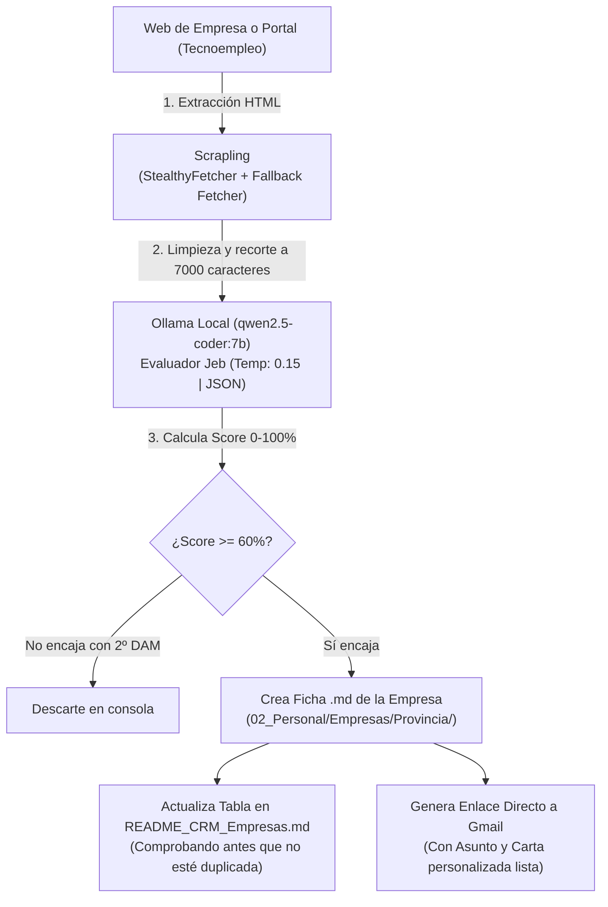

<div align="center">

# AI Job Matcher & Smart CRM — Automatización con IA Local
### **Búsqueda, Filtrado Racional de Ofertas y Gestión de Candidaturas FCT en Obsidian**

<p align="center">
  
  
  
</p>

<!-- Iconos Tecnológicos con Nombre -->
<table align="center">
  <tr>
    <td align="center" width="110">
      
      <br><sub><b>Python</b></sub>
    </td>
    <td align="center" width="110">
      
      <br><sub><b>Qwen 2.5 (7B)</b></sub>
    </td>
    <td align="center" width="110">
      
      <br><sub><b>Scrapling</b></sub>
    </td>
    <td align="center" width="110">
      
      <br><sub><b>Obsidian CRM</b></sub>
    </td>
  </tr>
</table>

**Herramienta de uso personal creada para automatizar la búsqueda y evaluación de empresas tecnológicas (Jaén, Granada y Málaga) de cara a mis prácticas de 2º de DAM. Combina Web Scraping con evasión de bloqueos, evaluación mediante un modelo de IA local en Ollama y generación automática de fichas y correos para Gmail.**

[Metodología (IA + Vibe Coding)](#1-metodología-conocimientos-de-ia--desarrollo-asistido) • [Cómo Funciona](#2-arquitectura-y-flujo-de-trabajo) • [Decisiones Técnicas de IA](#3-decisiones-técnicas-aplicadas-al-modelo-local) • [Estructura de Scripts](#4-estructura-del-proyecto) • [Límites Reales](#5-límites-actuales-y-realismo-técnico) • [Uso](#6-guía-de-ejecución)

</div>

---

> [!NOTE]
> ### Filosofía de Desarrollo & AI-Assisted Engineering
> *"Tenía claros los conceptos de IA (tokens, temperatura, prompts estructurados y modelos locales con Ollama) y el problema real que quería resolver. Utilicé la IA como 'pair programmer' para descubrir e integrar librerías en Python como Scrapling y construir este pipeline de automatización paso a paso."*

---

## 1. Metodología: Conocimientos de IA + Desarrollo Asistido

Este proyecto es mi primer sistema completo construido combinando **mis conocimientos previos sobre Inteligencia Artificial** con **programación asistida por IA (Vibe Coding guiado)**:

- **Dirección y Criterio Técnico (Mi aportación):** Habiendo estudiado por mi cuenta cómo funcionan los LLMs por dentro, definí la arquitectura del sistema, el diseño del System Prompt (el evaluador "jeb"), el control de la **ventana de contexto** para evitar alucinaciones, el ajuste de la **temperatura** para obtener respuestas racionales y la exigencia de salidas estructuradas en **JSON** ejecutándose 100% en local con **Ollama**.
- **Descubrimiento de Librerías e Implementación (Asistencia IA):** Utilicé la IA como copiloto técnico para aprender a implementar librerías específicas de Python que no conocía (Scrapling para saltar protecciones Cloudflare, urllib.parse para codificar enlaces de correo y argparse para crear comandos de terminal), iterando y validando cada bloque de código hasta entender su funcionamiento completo.

---

## 2. Arquitectura y Flujo de Trabajo



---

## 3. Decisiones Técnicas Aplicadas al Modelo Local

Para que un modelo local de 7 mil millones de parámetros (`qwen2.5-coder:7b`) funcione como un filtro fiable y no falle, se aplicaron cuatro mecanismos clave en el código:

### 1. Control de la Ventana de Contexto (`contenido_limpio[:7000]`)
Antes de enviar el texto extraído de la página web a Ollama, se filtran únicamente las etiquetas con contenido real (`h1, h2, h3, p, li`) y **se limita el texto a los primeros 7.000 caracteres**.
- **Por qué:** Evita saturar el límite de tokens del modelo local, reduce drásticamente el tiempo de respuesta en el PC y evita que la IA sufra alucinaciones al leer textos irrelevantes del pie de página (avisos legales, políticas de cookies o menús).

### 2. Racionalidad y Cero Invención (`temperature: 0.15`)
En la llamada a `ollama.chat()`, se fija la temperatura en **`0.15`**.
- **Por qué:** Una temperatura alta hace que el modelo sea creativo pero propenso a inventar datos. Al bajarla casi a cero, obligamos al modelo a ser estrictamente racional y ceñirse a las tecnologías que aparecen de verdad en la oferta frente a mi perfil (Flutter, Java, Node.js, SQL).

### 3. Salida Estructurada Obligatoria (`format="json"`)
Se activa el modo `format="json"` de Ollama junto con el esquema exacto en el prompt (`empresa`, `score`, `encaja`, `stack_tecnico`, `motivos_decision`, `carta_motivacion_personalizada`).
- **Por qué:** Impide que la IA añada texto conversacional antes o después de la respuesta, garantizando que `json.loads()` en Python pueda leer la decisión sin dar errores de sintaxis.

### 4. Doble Fetcher contra Bloqueos (`StealthyFetcher` + `Fetcher`)
- Primero intenta acceder con `StealthyFetcher(solve_cloudflare=True)`, que levanta un navegador camuflado capaz de superar las protecciones anti-bot de Cloudflare.
- Si por algún motivo el navegador da error o timeout, el código cuenta con un bloque de respaldo (fallback) que utiliza `Fetcher.get()` para realizar una petición HTTP ligera tradicional.

---

## 4. Estructura del Proyecto

```text
├── empresa_matcher.py      # Motor central: Scraping, evaluación con Ollama, creación de fichas .md y edición del CRM
├── buscar_empresas.py      # CLI principal con argumentos (--url, --keyword, --ciudad, --headless, --no-save)
├── abrir_correo.py         # Lector de fichas .md que abre en el navegador el borrador de Gmail listo para enviar
├── evaluar_jaen.py         # Script de escaneo automático de ofertas tecnológicas en la provincia de Jaén
├── evaluar_granada.py      # Script de escaneo automático de ofertas tecnológicas en la provincia de Granada
└── evaluar_malaga.py       # Script de escaneo automático de ofertas tecnológicas en la provincia de Málaga
```

### Funcionamiento de la actualización del CRM y el botón de Gmail
- **Actualización de tablas sin duplicados (`actualizar_dashboard_crm`):** El script lee el archivo `README_CRM_Empresas.md` como texto plano. Primero comprueba con un condicional si la ruta de la empresa ya existe en el documento para no repetirla. Si es nueva, localiza mediante `.split()` el encabezado de la provincia correspondiente (`## 📍 Jaén`, `## 📍 Granada` o `## 📍 Málaga`) e inserta la nueva fila justo antes del cierre de la tabla (`---`).
- **Borrador de Gmail sin usar APIs ni contraseñas:** Aprovecha los parámetros de URL de redacción de Google (`https://mail.google.com/mail/?view=cm&fs=1&to=...&su=...&body=...`). Usando `urllib.parse.urlencode`, inyecta el correo de RRHH, el asunto y la carta de motivación directamente en el enlace para abrirlo en un clic en el navegador.

---

## 5. Límites Actuales y Realismo Técnico

1. **Búsqueda de listas acoplada a Tecnoempleo:** La función `scrapear_ofertas_tecnoempleo()` busca selectores CSS específicos del HTML de ese portal (`div.p-3`, `h3 a`). En portales cerrados que exigen login obligatorio o tienen anti-scraping agresivo (como LinkedIn o InfoJobs), la búsqueda masiva por listas no funciona directamente.
2. **Evaluación individual (`--url`) universal:** Cuando se le pasa la URL directa de la web de cualquier empresa, el script utiliza selectores genéricos (`h1, h2, p, li`), por lo que puede analizar casi cualquier página corporativa pública.
3. **Dependencia del hardware local:** La velocidad de evaluación depende de tener **Ollama** abierto en segundo plano ejecutando el modelo `qwen2.5-coder:7b`.

---

## 6. Guía de Ejecución

### Requisitos previos
1. Tener [Ollama](https://ollama.com/) instalado con el modelo descargado:
   ```bash
   ollama pull qwen2.5-coder:7b
   ```
2. Instalar las librerías de Python necesarias:
   ```bash
   pip install -r requirements.txt
   ```

### Ejemplos de uso por consola
```bash
# 1. Analizar directamente la web de una empresa concreta y guardar su ficha si encaja
python buscar_empresas.py --url "https://www.innovasur.com" --ciudad "jaen"

# 2. Buscar ofertas por palabra clave y provincia viendo el navegador en directo
python buscar_empresas.py --keyword "flutter" --ciudad "granada"

# 3. Ejecutar el escaneo completo de una provincia en segundo plano
python evaluar_jaen.py

# 4. Abrir en el navegador el correo de Gmail ya redactado para una empresa guardada
python abrir_correo.py "Petroprix"
```

---

## Autor

**Ángel Miranda Molina**  
*Estudiante de 2º de DAM (Desarrollo de Aplicaciones Multiplataforma)*  

[](https://www.linkedin.com/in/%C3%A1ngel-miranda-75966b344/)
[](https://github.com/Angeell04)
